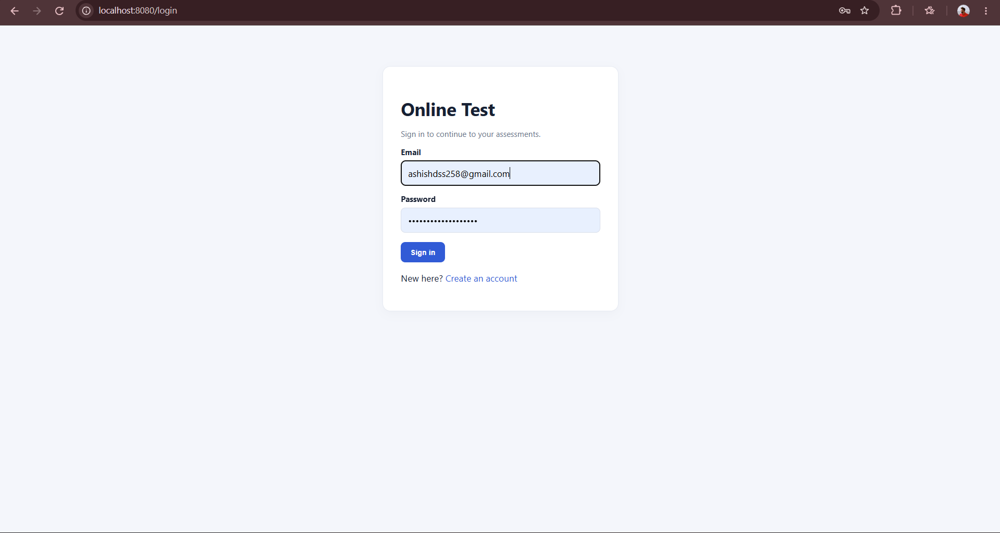
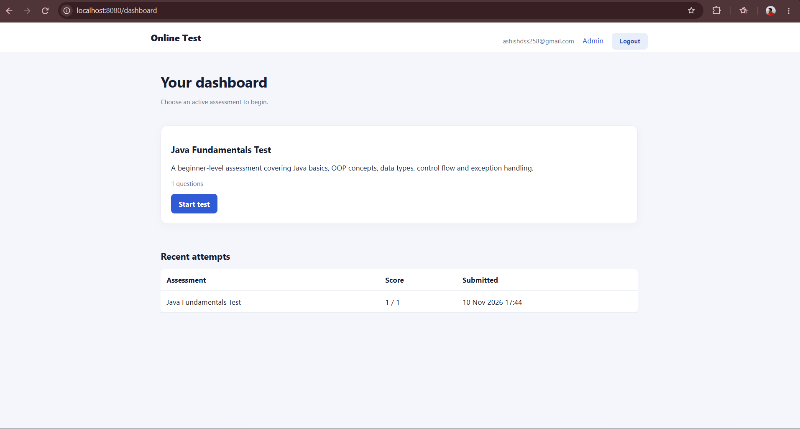

# Online Test Management System

A full-stack web application for creating, managing and attempting online assessments. Built using Java, Spring Boot, Spring Security, Thymeleaf and MySQL.

## Overview

The Online Test Management System provides separate experiences for administrators and students. Administrators can manage assessments and questions, while registered users can attempt active assessments and review their scores.

## Features

### Authentication and security
- User registration and login
- Secure password hashing using BCrypt
- Role-based access control for USER and ADMIN
- Protected administrator routes
- CSRF protection for form submissions

### Administrator
- Create assessments with titles and descriptions
- Add multiple-choice questions
- Configure answer options and correct answers
- Activate or deactivate assessments

### Student
- View available active assessments
- Attempt multiple-choice tests
- Automatic score calculation
- View recent assessment attempts and scores

## Technology Stack

| Area | Technology |
|---|---|
| Language | Java 17 |
| Backend | Spring Boot 3.3.5 |
| Security | Spring Security |
| Frontend | Thymeleaf, HTML, CSS |
| Persistence | Spring Data JPA, Hibernate |
| Database | MySQL 8 |
| Build | Maven |

## Application Requirements

- Java Development Kit (JDK) 17 or later
- Maven 3.8 or later
- MySQL 8 or later
- Git

## Getting Started

### 1. Clone the repository

```bash
git clone https://github.com/ashishjha2910/Online-Test-Management-System.git
cd Online-Test-Management-System
```

### 2. Create the database

Log in to MySQL and execute:

```sql
CREATE DATABASE onlinetest_db;
```

### 3. Configure database credentials

The application supports environment-based configuration.

```bash
export DB_URL='jdbc:mysql://localhost:3306/onlinetest_db?createDatabaseIfNotExist=true&useSSL=false&serverTimezone=UTC'
export DB_USER='your_mysql_username'
export DB_PASSWORD='your_mysql_password'
```

Use credentials for a MySQL account that has access to `onlinetest_db`. Do not commit real passwords or secrets to GitHub.

### 4. Build and run tests

```bash
mvn clean test
```

To package the application:

```bash
mvn clean package
```

### 5. Start the application

```bash
mvn spring-boot:run
```

Open the application at:

**http://localhost:8080**

Hibernate manages the application tables through the configured JPA schema-generation setting.

## First-Time Administrator Setup

1. Register an account through `/register`.
2. Log in using `/login`.
3. Promote the intended account to administrator directly in MySQL:

```sql
UPDATE users
SET role = 'ADMIN'
WHERE email = 'your-email@example.com';
```

4. Log out and log in again to refresh the authenticated role.
5. Open the Admin interface and create an assessment.

New registrations receive the `USER` role. Administrator privileges should only be assigned through a trusted administrative process.

## Application Routes

| Route | Purpose |
|---|---|
| `/register` | User registration |
| `/login` | User login |
| `/dashboard` | Assessment dashboard and attempt history |
| `/quiz/{id}` | Attempt an assessment |
| `/admin` | Administrator assessment management |

Administrator routes require the ADMIN role.

## Project Structure

```text
src/
└── main/
    ├── java/com/onlinetest/
    │   ├── config/       # Security configuration
    │   ├── controller/   # Application routes
    │   ├── model/        # JPA entities
    │   ├── repository/   # Data access
    │   └── service/      # Business logic
    └── resources/
        ├── templates/    # Thymeleaf pages
        └── static/css/   # Stylesheets
```

## Security Notes

- Passwords are stored as BCrypt hashes.
- Access to protected routes is handled by Spring Security.
- Administrator functionality is restricted by role.
- CSRF protection is enabled for form submissions.
- Database credentials should be supplied through environment variables and never committed.

## Author

**Ashish Kumar**

- GitHub: [ashishjha2910](https://github.com/ashishjha2910)

---

If you find an issue or have a suggestion, feel free to open a GitHub issue.

## Screenshots

| Application Preview | Screenshot |
|---|---|
| Preview 1 |  |
| Preview 2 |  |
